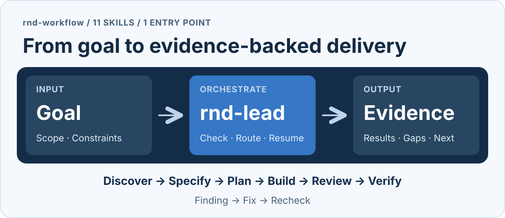

# rnd-workflow

[简体中文](README.md) · **English**

> Give an AI agent a development goal. Let 11 skills hand work off as needed, and verify delivery against evidence from the current artifact.

rnd-workflow is a lightweight skill collection for individual developers using Codex, DSH, or Claude Code. Its entry point, `rnd-lead`, connects discovery, specification, planning, implementation, review, and verification as the task requires. It continues within the confirmed scope and records the current state for the next session.



[Quick start](#quick-start) · [Install](#install) · [How it works](#how-it-works) · [The 11 skills](#the-11-skills) · [Detailed guide (Chinese)](guide.md)

## Quick start

[Install the skills](#install) in the **application project you want to work on**, then send this message in that project's session:

```text
$rnd-lead
Goal: <the current request>.
Inputs: <requirements, relevant entry points, or the current task record>.
Scope and constraints: <what may change and what must remain compatible>.
Completion target: local implementation, necessary tests, applicable review, and verification.
The scope above is clear. Continue through ordinary skill transitions without pausing.
Deliver the actual changes, current evidence, and remaining items. Do not deploy in this task.
```

Replace the placeholders and send it as a **session message**, not a terminal command. The example uses Codex syntax; DSH and Claude Code use the invocations below.

| Host | Project-local skills directory | Session invocation |
| --- | --- | --- |
| Codex | `<project>/.agents/skills/` | `$rnd-lead …` |
| DSH | `<project>/.dsh/skills/` | `invoke skill(rnd-lead) …` |
| Claude Code | `<project>/.claude/skills/` | `/rnd-lead …` |

For a plan-first request, continuation, or review-only request, see [how to choose an entry point (Chinese)](guide.md#快速选择入口). The [detailed guide (Chinese)](guide.md) explains each role, stop conditions, and evidence reuse.

## Install

Copy all 11 `rnd-*` folders from [`skills/`](skills/) into the appropriate directory above. Keep each folder complete, including `SKILL.md`, `references/`, `LICENSE`, and `THIRD_PARTY_NOTICES.md`. A host's configured personal skills directory can also serve multiple projects. Refresh the skills list or reopen the session after copying; compare any existing skills with the same names before replacing customizations.

Loading the skills requires no installer, Node/npm, or collection runtime. DSH uses the nearest ancestor Git root as its project root, or the startup working directory when there is no Git repository.

## How it works

`rnd-lead` coordinates the next action; each task does not need every role. Use it to start a project, add a feature, fix a defect, or refactor while preserving behavior. A clear, low-risk fix can go directly to implementation and verification. Larger tasks can be split around verifiable outcomes. Architecture, UI, security, and release roles join when applicable. Development still uses the application project's own tools and permissions. One agent may perform several roles in sequence, but its own review must be identified as non-independent.

| Convention | In practice |
| --- | --- |
| **Keep moving** | Select the next action within confirmed scope. Ordinary skill transitions and an initial split into batches do not automatically stop work. |
| **Close findings** | Route a review finding to its responsible author, then recheck that specific finding and update its state. |
| **Resume from facts** | Check goals, scope, artifacts, evidence, and remaining items in the project's existing README or task record. |
| **Deliver with evidence** | Match acceptance to tests, interactions, reviews, or release facts for the current version, and state what remains unverified. |

You still decide material unresolved choices that change behavior or scope. The skills do not provide machine-enforced state control or automatic gates. Results depend on model adherence, context, and available tools; permissions, CI gates, and concurrency controls come from the host and application project.

### Starting from an idea or PRD

`rnd-discover` can clarify an incomplete brief and raise consequential questions. Once the current batch is clear, `rnd-spec` defines testable behavior and `rnd-plan` maps the work and checks. A PRD with precise behavior and acceptance can serve as the specification without another document. Unresolved future features do not block a confirmed batch, and permission to continue does not decide unknown business rules. Project rules continue to use the project's existing entry points and apply according to scope. See [requirements and rules preparation (Chinese)](guide.md#25-prd-迭代规格准备与项目规则).

### Common tasks

| Task | Check first |
| --- | --- |
| Build from scratch | Users, first-version scenarios, and technical constraints; define a testable user outcome. |
| Add a feature or fix a defect | Existing entry points, relevant tests, and reproduction; cover affected behavior. |
| Refactor or migrate | Existing behavior, interfaces, and data; decide what to retain, change, or discard. |
| Run technical research | The question, hypothesis, method, and samples; keep raw results and limitations. |
| Release or resume | Current candidate, environment, evidence, and scope; distinguish development completion from verified deployment. |

## The 11 skills

| Skill | Responsibility |
| --- | --- |
| [rnd-lead](skills/rnd-lead/SKILL.md) | Orchestration, current state, and handoffs |
| [rnd-discover](skills/rnd-discover/SKILL.md) | Requirements, scope, legacy inventory, and research |
| [rnd-spec](skills/rnd-spec/SKILL.md) | Current specification and testable acceptance |
| [rnd-plan](skills/rnd-plan/SKILL.md) | Implementation slices, dependencies, and checks |
| [rnd-build](skills/rnd-build/SKILL.md) | Implementation, tests, root-cause debugging, and experiments |
| [rnd-review](skills/rnd-review/SKILL.md) | Artifact review, findings, and specific rechecks |
| [rnd-verify](skills/rnd-verify/SKILL.md) | Completion claims, evidence, and gaps |
| [rnd-release](skills/rnd-release/SKILL.md) | Release preparation, authorized deployment, and observations |
| [rnd-architecture](skills/rnd-architecture/SKILL.md) | Necessary architecture, interfaces, and data models |
| [rnd-design](skills/rnd-design/SKILL.md) | Interaction, visual, accessibility, and rendered observations |
| [rnd-security](skills/rnd-security/SKILL.md) | Security review based on actual risk |

Install the whole collection for the complete workflow, or invoke a role on its own. Invoking `rnd-review` alone, for example, produces review findings and suggestions. For an interface or prototype, start with `rnd-lead` and use `rnd-design` when user-visible behavior calls for it. Delivery should say what was run or observed, whether services were real or mocked, and what remains unverified. See the [frontend and prototype guide (Chinese)](guide.md#前端与原型开发).

## Evidence and boundaries

- The specification role maintains acceptance criteria. An implementation failure does not justify weakening them; actual requirement changes update affected downstream work.
- Evidence must match the current artifact, including the actual command, working directory, exit code, and output. UI changes also need applicable interaction and visual observations.
- Report unrun, interrupted, simulated, and unverified work separately. An old success cannot override a new failure.
- Local development completion, release readiness, and verified deployment are distinct states. Actual deployment requires an explicit candidate, environment, and authorization.

## Package contents and license

This directory is a distributable skill package. It contains 11 complete skill folders, usage documentation, and the workflow diagram shown in the Chinese README. The maintenance source, packaging scripts, and packaging record are excluded from the published content. The package also excludes a behavioral case set and project-level documents.

The collection synthesizes and adapts methods from GSD, pm-skills, Spec Kit, Superpowers, agent-skills, HumanLayer, and security-audit-skill. Each skill's `references/methods.md` and `sources.json` record sources and adaptations. The collection uses the **MIT License**; licenses and third-party attribution remain in each skill's `LICENSE` and `THIRD_PARTY_NOTICES.md`.
