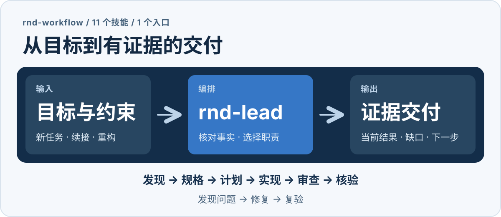

# rnd-workflow

**简体中文** · [English](README.en.md)

> 说清研发目标，让 11 个 AI 技能按需接续工作；用当前产物的证据判断是否完成。

rnd-workflow 是面向个人开发者的轻量技能集合，适用于 Codex、DSH 和 Claude Code。以 `rnd-lead` 为入口，它根据任务连接需求、规格、计划、实现、审查、核验等职责，在已确认范围内继续推进，并留下可供下次会话核对的当前状态。



[快速开始](#快速开始) · [安装](#安装) · [工作方式](#工作方式) · [11 个技能](#11-个技能) · [四种起点示例](USAGE.md) · [详细指南](guide.md)

## 快速开始

先按[安装说明](#安装)把技能放进**实际要开发的项目**，然后在该项目的会话中发送：

```text
$rnd-lead
目标：〔本次需求〕。
依据：〔需求文档、相关入口或当前任务记录〕。
范围与约束：〔允许修改什么、需要兼容什么〕。
完成要求：本地实现、必要测试、适用审查和逐项核验。
上述范围已明确，请连续完成，普通技能切换不暂停。
交付实际修改、当前证据和未完成项，本次不部署。
```

替换占位内容后作为**会话消息**发送，不是在终端运行。上例使用 Codex 写法；DSH 和 Claude Code 的调用方式见下表。

| 宿主 | 项目内技能目录 | 会话调用 |
| --- | --- | --- |
| Codex | `<项目>/.agents/skills/` | `$rnd-lead …` |
| DSH | `<项目>/.dsh/skills/` | `调用 skill(rnd-lead) …` |
| Claude Code | `<项目>/.claude/skills/` | `/rnd-lead …` |

想先评审方案、继续上次任务，或只做审查？[四种起点使用说明](USAGE.md)提供可改写的 Prompt；[完整指南](guide.md)解释各角色、停止点和证据复用。

## 安装

将 [`skills/`](skills/) 中的 11 个 `rnd-*` 文件夹**完整复制**到上表对应目录，保留各目录的 `SKILL.md`、`references/`、`LICENSE` 和 `THIRD_PARTY_NOTICES.md`。也可放入宿主已配置的个人技能目录，供多个项目使用。复制后刷新技能列表或重开会话；已有同名技能时先核对差异并保留定制。

加载技能无需安装脚本、Node/npm 或集合运行时。DSH 以最近祖先 Git 根为项目根；没有 Git 仓库时使用启动 cwd。

## 工作方式

`rnd-lead` 负责接续，不要求每项任务都走完全部角色。它可用于从零开发、新增功能、修复缺陷和保持行为的重构。明确、低风险的小修可直接实施与验证；复杂任务按可验收的结果分批。架构、界面、安全和发布职责仅在适用时进入。实际开发使用业务项目自己的工具和权限。一个 Agent 可以顺序承担多个职责，但自身审查须如实标记为非独立审查。

| 约定 | 实际做法 |
| --- | --- |
| **持续推进** | 在已确认范围内选择下一项工作；普通技能切换或首次分批不自动成为停止点。 |
| **问题闭环** | 审查发现交由责任作者修复，再对具体发现复验并更新状态。 |
| **按事实续接** | 从项目现有 README 或任务记录核对目标、范围、产物、证据和剩余项。 |
| **按证据交付** | 将验收对应到当前版本的测试、操作、审查或发布事实，并说明未验证部分。 |

会改变行为或范围的重大未决选择仍由用户决定。技能正文不提供机器强制状态控制或自动门禁；实际效果取决于模型遵循、上下文和可用工具。权限、CI 门禁和并发控制由宿主及业务项目提供。

### 从想法或 PRD 开始

`rnd-discover` 可先整理不完整的需求并提出关键问题；当前批次清晰后，`rnd-spec` 定义可验收行为，`rnd-plan` 安排实施与证明方式。已有精确行为和验收的 PRD 可直接作为规格，不强制另建文档。未明确的后续功能不阻塞已确认批次；连续执行授权也不能代替尚未决定的业务规则。项目 Rules 沿用现有入口，并按适用范围核对。详见[需求与规则准备](guide.md#25-prd-迭代规格准备与项目规则)。

### 常见任务

| 任务 | 首先核对 |
| --- | --- |
| 从零开发 | 用户、首版场景与技术约束，形成可测试的完整用户结果。 |
| 新增功能或修复缺陷 | 现有入口、相关测试与问题复现，覆盖受影响的旧行为。 |
| 保持行为的重构或迁移 | 旧行为、接口和数据基线，明确保留、改造与舍弃。 |
| 技术调研 | 问题、假设、方法和样本，保留原始结果与局限。 |
| 发布或续接 | 当前候选、环境、证据与范围，区分研发完成和真实上线验证。 |

## 11 个技能

| 技能 | 职责 |
| --- | --- |
| [rnd-lead](skills/rnd-lead/SKILL.md) | 编排入口、当前状态与职责接续 |
| [rnd-discover](skills/rnd-discover/SKILL.md) | 需求迭代、范围、旧功能盘点与研究分析 |
| [rnd-spec](skills/rnd-spec/SKILL.md) | 当前规格与可测试验收 |
| [rnd-plan](skills/rnd-plan/SKILL.md) | 实施切片、依赖与检查 |
| [rnd-build](skills/rnd-build/SKILL.md) | 实现、测试、根因调试与实验执行 |
| [rnd-review](skills/rnd-review/SKILL.md) | 审查产物、报告发现与具体复验 |
| [rnd-verify](skills/rnd-verify/SKILL.md) | 逐项核对完成声明、证据与缺口 |
| [rnd-release](skills/rnd-release/SKILL.md) | 发布准备、已授权部署与观测 |
| [rnd-architecture](skills/rnd-architecture/SKILL.md) | 必要的架构、接口与数据模型决策 |
| [rnd-design](skills/rnd-design/SKILL.md) | 交互、视觉、无障碍与渲染观察 |
| [rnd-security](skills/rnd-security/SKILL.md) | 按实际风险开展安全审查 |

完整流程建议安装全部技能，也可单独调用一个角色；例如只调用 `rnd-review` 时，仅交付审查发现与建议。界面和原型任务可从 `rnd-lead` 开始，涉及用户可见流程时按需使用 `rnd-design`；具体运行、真实服务或模拟数据及未验证部分须在交付中说明。见[前端与原型开发](guide.md#前端与原型开发)。

## 交付依据与边界

- 验收由规格职责维护；实现失败不能通过放宽验收消除。需求变化须同步到受影响的下游工作。
- 证据须对应当前产物，写明实际命令、工作目录、退出码与输出；界面变化还需适用的操作和视觉观察。
- 未运行、中断、模拟和未验证的部分应分别说明；旧的成功不能覆盖新的失败。
- 本地研发完成、发布就绪和上线验证是不同状态；实际部署需要明确候选、环境与授权。

## 包内容与许可

当前目录是技能分发包，包含 11 个可复制的技能文件夹、使用文档和本页流程图；生成时的维护源与打包脚本不包含在包中。版本及打包时的来源状态见 [PACKAGE-INFO.md](PACKAGE-INFO.md)。本包也不包含行为案例集或项目级文档。

本集合综合并适配 GSD、pm-skills、Spec Kit、Superpowers、agent-skills、HumanLayer 和 security-audit-skill 等方法。各技能的 `references/methods.md` 与 `sources.json` 记录来源及适配信息。本集合采用 **MIT License**；许可与第三方归属随每个技能保留，见各目录的 `LICENSE` 与 `THIRD_PARTY_NOTICES.md`。
